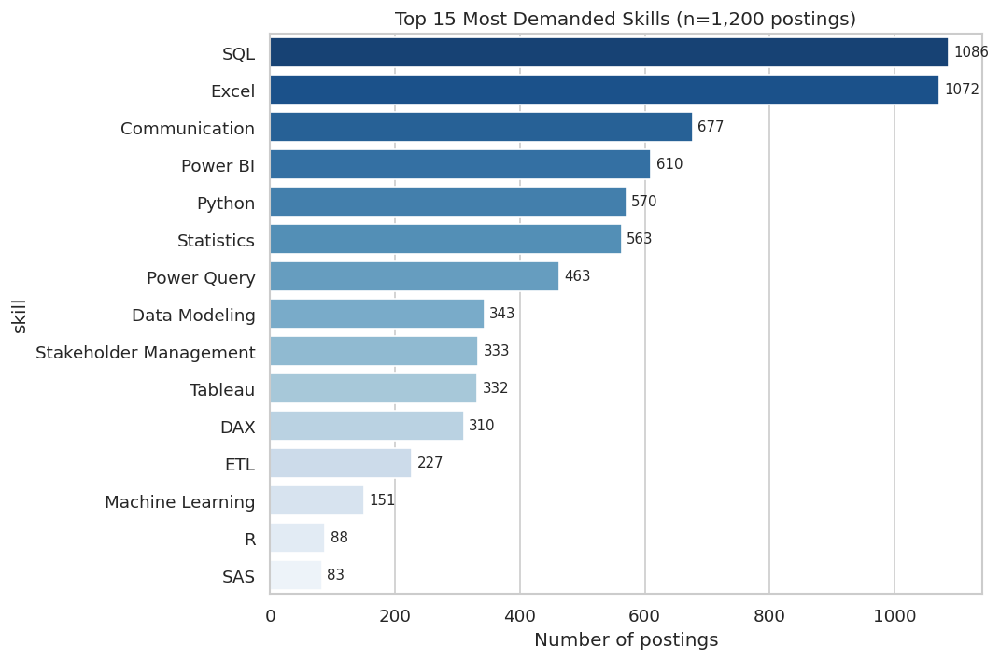
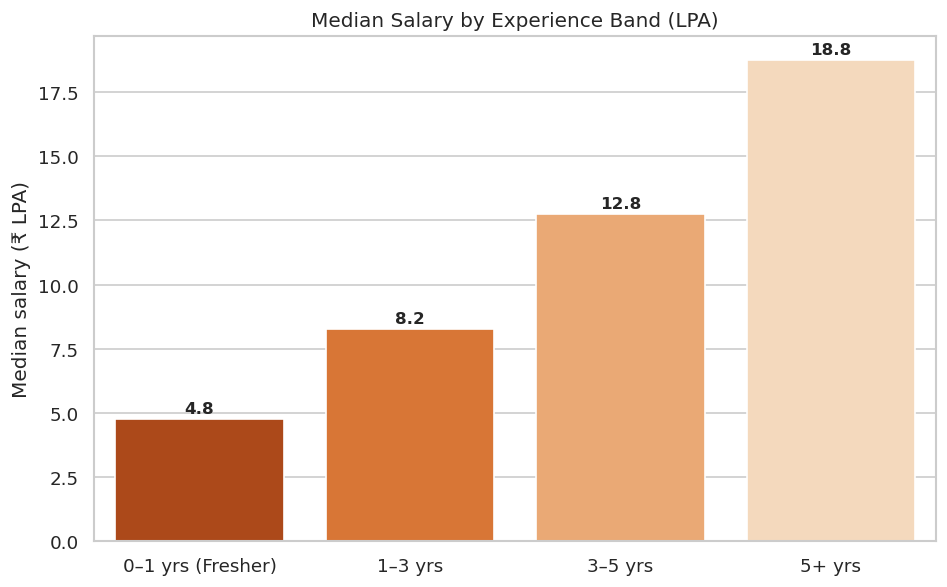
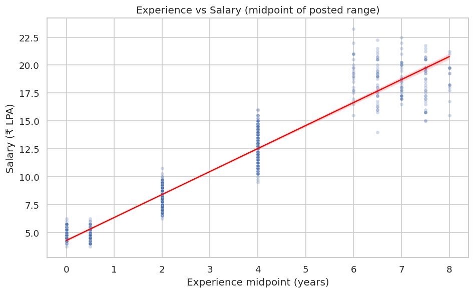
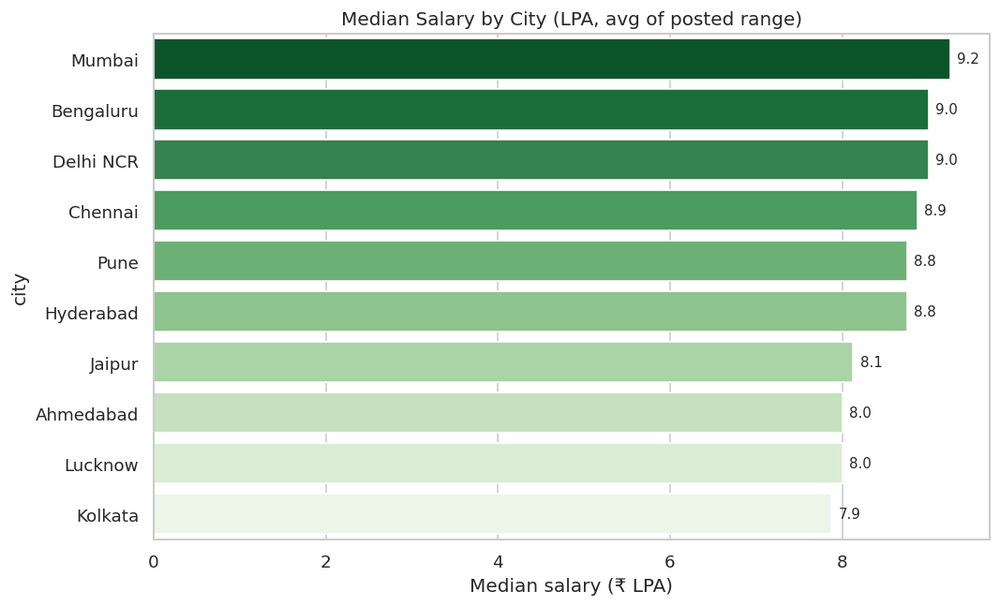
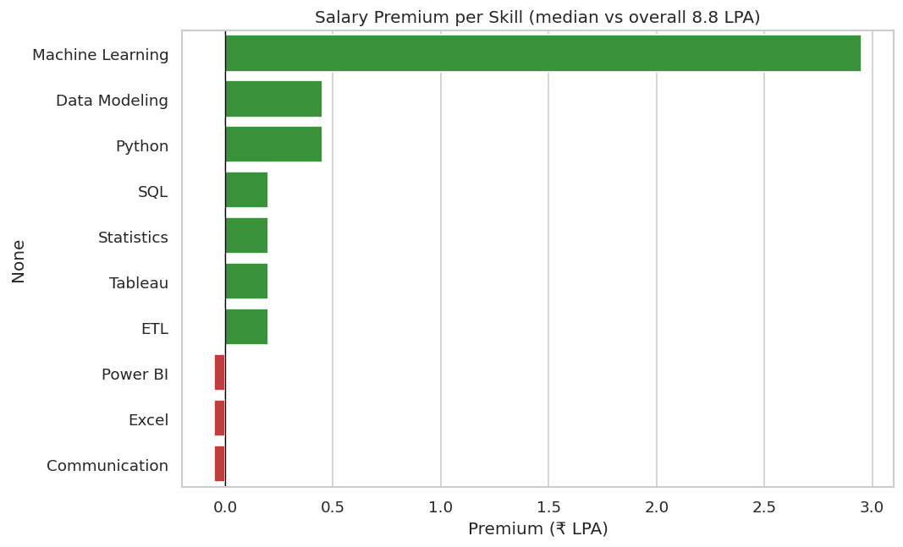
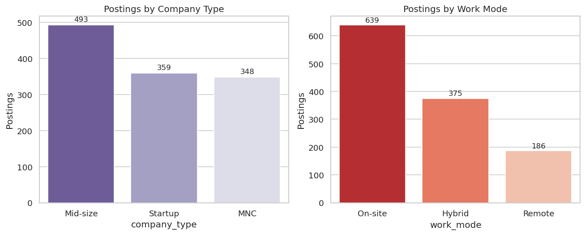

# Indian Data Analyst Job Market Analytics 📊

Hi, I'm **Vivek Saini** — a Data Analyst from Meerut, India. While applying for Data Analyst, Business Analyst, and MIS Executive roles, I kept asking myself the same questions: *Which skills do employers actually want? Does the city really change the pay? Is it worth learning ML right now, or should I double down on SQL?*

Instead of guessing, I decided to analyse the job market the way I'd analyse any business problem — with data.

> 📓 **Start here:** the full analysis, step by step with charts and commentary, is in **[job_market_analytics.ipynb](job_market_analytics.ipynb)**. The scripts below reproduce everything.

## What I wanted to find out

1. Which skills do employers ask for most?
2. How does pay vary by city, experience, company type, and work mode?
3. Which skills carry a salary *premium* — and is that premium real, or just seniority in disguise?

## A quick, honest note about the data

I didn't scrape any job board. The dataset (`data/job_postings.csv`, 1,200 postings) is **synthetically generated** by me (`generate_data.py`, seed 42) — fictional companies, but salary bands, skill mixes, and city differences modelled on real Indian market patterns (freshers ≈ ₹3–6 LPA, 5+ years ≈ ₹12–22 LPA, Tier-1 city premium). I built it this way to demonstrate the complete workflow — data generation, cleaning, analysis, visualisation — in a fully reproducible way. Treat the findings as *patterns worth testing against real postings*, which is literally my next step (see below).

## The dataset at a glance

| | |
|---|---|
| **Postings** | 1,200 |
| **Roles** | Data Analyst (651), Business Analyst (169), MIS Executive (163), Senior Data Analyst (136), Analytics Associate (81) |
| **Cities** | 10 — Delhi NCR, Mumbai, Bengaluru, Hyderabad, Chennai, Pune, Kolkata, Ahmedabad, Jaipur, Lucknow |
| **Columns** | role, company, city, experience range, salary range (₹ LPA), skills, company type, work mode, posted date |

## What the data says

**Overall median salary: ₹8.8 LPA** across all 1,200 postings.

### 1. SQL and Excel run the show
| # | Skill | Postings | Share |
|---|---|---|---|
| 1 | SQL | 1,086 | 90.5% |
| 2 | Excel | 1,072 | 89.3% |
| 3 | Communication | 677 | 56.4% |
| 4 | Power BI | 610 | 50.8% |
| 5 | Python | 570 | 47.5% |
| 6 | Statistics | 563 | 46.9% |
| 7 | Power Query | 463 | 38.6% |
| 8 | Data Modeling | 343 | 28.6% |
| 9 | Stakeholder Management | 333 | 27.8% |
| 10 | Tableau | 332 | 27.7% |
| 11 | DAX | 310 | 25.8% |
| 12 | ETL | 227 | 18.9% |
| 13 | Machine Learning | 151 | 12.6% |
| 14 | R | 88 | 7.3% |
| 15 | SAS | 83 | 6.9% |

SQL in 90.5% of postings settled my biggest doubt — it's not optional. And Communication ranking #3 (56.4%) was a genuine surprise: more than half the postings ask for it explicitly.



### 2. Experience pays — steeply
| Experience | Median salary (₹ LPA) |
|---|---|
| 0–1 yrs (Fresher) | 4.8 |
| 1–3 yrs | 8.2 |
| 3–5 yrs | 12.8 |
| 5+ yrs | 18.8 |

The 5+ years median is **~3.9× the fresher median**, and the experience–salary correlation is **0.96**. As a fresher, this was oddly motivating: the early years compound, so the first role's learning matters more than its label.




### 3. City matters (but less than experience)
| City | Median (₹ LPA) | | City | Median (₹ LPA) |
|---|---|---|---|---|
| Mumbai | 9.2 | | Hyderabad | 8.8 |
| Bengaluru | 9.0 | | Jaipur | 8.1 |
| Delhi NCR | 9.0 | | Ahmedabad | 8.0 |
| Chennai | 8.9 | | Lucknow | 8.0 |
| Pune | 8.8 | | Kolkata | 7.9 |

Mumbai vs Kolkata is a ₹1.3 LPA gap — real, but small next to the experience effect. Worth weighing against cost of living before relocating for a headline number.



### 4. The ML premium is real — and partly an illusion
| Skill | Premium vs overall median (₹ LPA) |
|---|---|
| Machine Learning | +2.95 |
| Data Modeling | +0.45 |
| Python | +0.45 |
| SQL | +0.20 |
| Statistics | +0.20 |

Machine Learning postings pay the most above median — **but** they also ask for a median of 4.0 years' experience vs 2.0 overall. A good chunk of that "skill premium" is seniority wearing a skill's clothes. Checking for a confounder before celebrating a number is the most valuable habit this project reinforced.



### 5. Remote is rare; skill *quality* beats quantity
- **Work mode:** On-site 639 (53.2%) · Hybrid 375 (31.2%) · Remote 186 (15.5%)
- **Company type:** Mid-size 493 · Startup 359 · MNC 348
- Listing *more* skills barely correlates with pay (r = 0.06). **Which** skills you have matters — not how many you can list.



## What I learned building this

- **pandas `explode()`** is the clean way to analyse multi-value columns (my skills were one semicolon-separated string per posting).
- **Medians over means** for salary data — a few high-end postings would have dragged the average up and lied to me.
- **Always check the confounder.** The ML premium looked like a headline until I compared experience levels.
- **Reproducibility is a feature:** fixed seed, a `findings.json` generated from the data, and a notebook that runs top-to-bottom — anyone can verify every number here.

## Run it yourself

```bash
pip install -r requirements.txt
python generate_data.py   # rebuild the dataset (seed 42)
python analysis.py        # metrics + charts + findings.json
# …or open job_market_analytics.ipynb and run all cells
```

## What's next

- [ ] Interactive **Power BI dashboard** on the CSV (slicers by city / experience / work mode)
- [ ] Validate these patterns against a small sample of **real** scraped postings
- [ ] NLP on real job descriptions to extract skills automatically
- [ ] Extend to Data Engineer / BI Developer roles for comparison

## Project structure

```
├── job_market_analytics.ipynb   # 📓 the full analysis, executed
├── data/job_postings.csv        # synthetic dataset (1,200 rows)
├── charts/                      # 6 PNG charts
├── generate_data.py             # reproducible data generation (seed 42)
├── analysis.py                  # pandas analysis + charts + findings.json
├── build_readme.py              # helper: findings → report tables
├── findings.json                # machine-readable results
├── requirements.txt
└── README.md
```

## Let's connect

I'm actively looking for Data Analyst / Business Analyst / MIS Executive opportunities and happy to discuss this project or the analysis behind it.

- 📧 vs03426@gmail.com
- 💼 LinkedIn: [Add your LinkedIn URL here]
- 📍 Meerut, Uttar Pradesh, India

*If you found this useful, a ⭐ would mean a lot to a fresher putting his work out there.*
